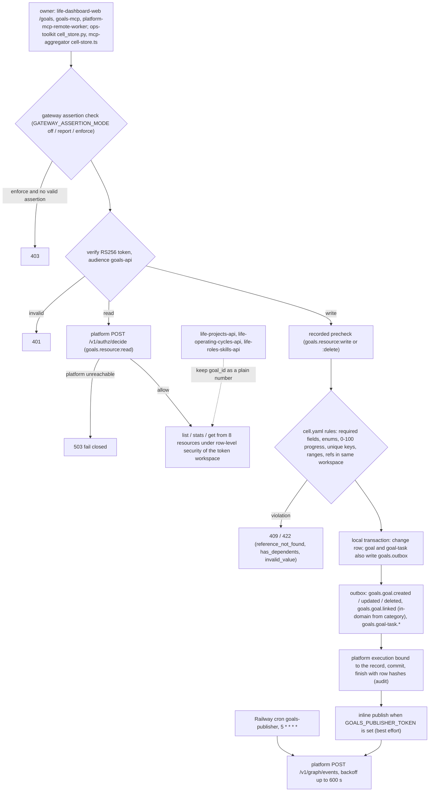

# 01 — Business process (As-Is / To-Be)

life-goals-api คือ cell ทะเบียนเป้าหมายของ owner: goal, task ของ goal, metric, portfolio mapping, productivity goal และ link ไปยัง project / context ของ `life-projects-api` ผู้เรียกคือ owner ผ่าน `life-dashboard-web` (`/goals`), `goals-mcp`, hosted tool hub และ automation ที่ถือ token ของ `empire-platform`; goal และ goal-task ส่ง event เข้า graph ของ platform

Last reviewed: 2026-11-27 · commit `59980b8`

## As-Is (จากโค้ดวันนี้)

Sources: `cell.yaml`, `pyproject.toml` (pinned `platform-cellkit` 1.1.13: `cellkit/app.py` `allow`, `write`, `emit`, `publish_soon`; `cellkit/publisher.py`; `cellkit/server.py` gateway install; `cellkit/spec.py` `audience`), `migrations/0001_goals.sql`, `migrations/0002_catalog_backfill.sql`, `.railway/railway.ts`, `README.md`, `PRODUCT.md` §Users

ข้อเท็จจริงสำคัญจากโค้ด:

- 8 resource: `goals`, `goal-tasks`, `goal-metrics`, `goal-portfolio-mappings`, `productivity-goals`, `goal-project-links`, `goal-context-links`, `goal-task-project-links`; แต่ละตัวมี list, stats, get, get-by-legacy-id, create (`Idempotency-Key`), patch (`expected_version`), delete และ `POST /v1/<plural>/erase` (ลบข้อมูลทั้ง workspace ของผู้เรียกเป็น batch, ต้องมี `:delete` และยืนยัน workspace id ของตัวเอง)
- มีเพียง `goal` (title, status, type, category, domain) และ `goal-task` (title, status, goal_id) ที่ส่ง graph event; resource อื่นมีแค่ audit
- `project_id` และ `context_id` เป็นตัวเลขเปล่า ไม่ตรวจกับ `life-projects-api`
- `0002_catalog_backfill.sql` เข้าคิว event `.updated` และ `goals.goal.linked` (in-domain) ให้ goal ที่มีอยู่ก่อนแล้ว; ส่งออกโดย publisher ตามปกติ
- `GATEWAY_ASSERTION_MODE` ค่าเริ่มต้น `off`; ค่าที่ใช้ใน production [ต้องยืนยัน]

## To-Be (จาก `PRODUCT.md` §Product Purpose และ §Measures)

- ทุก goal ที่ active มีอยู่ครั้งเดียว พร้อม task และ key result ที่วัดได้; goal หนึ่งมี portfolio mapping ไม่เกินหนึ่ง; link แต่ละคู่ไม่ซ้ำ
- goal ที่ active ไม่มี portfolio mapping: เป้า 0
- ตัววัดที่เสนอ (ยังไม่มีอะไรเก็บ): goal ที่ active มี metric และ project link อย่างน้อยหนึ่ง, task ที่ `done` ต่อสัปดาห์, อายุแถว outbox ที่เก่าสุดที่ยังไม่ publish, 5xx และ p95 ของ `/v1/goals`
- out of scope: คำนวณ progress หรือสถานะ metric จาก task / telemetry

ไม่มี diagram To-Be ของกระบวนการใน repo (`specs/001`, `specs/002` เป็นงาน baseline และ test depth)

## Gap

| ID | As-Is → To-Be | Status | Owner | Evidence |
|---|---|---|---|---|
| G1 | ไม่มีอะไรนับ goal ที่ active แต่ไม่มี portfolio mapping → เป้า 0 | todo | claude | `PRODUCT.md` §Measures ("nothing collects them yet") |
| G2 | event ของ goal / goal-task เข้าคิวและส่งแล้วในโค้ด แต่ยังไม่ยืนยันว่ามาถึง graph → ยืนยันแล้ว | todo | claude | `PRODUCT.md` §Operating Context [ต้องยืนยัน]; `cell.yaml` `graph:` |
| G3 | ตัววัดที่เสนอใน §Measures ยังไม่มีการเก็บ → เก็บได้ | todo | claude | `PRODUCT.md` §Measures |
| G4 | ไม่มี To-Be ของกระบวนการที่เขียนไว้ (diagram หรือ spec) → owner กำหนด | decide | owner | ไม่มีใน `PRODUCT.md` / `specs/` |

## Open questions

- `PRODUCT.md` §Operating Context บอกว่า `goals-publisher` รันทุก 15 นาที แต่ `.railway/railway.ts` และ `README.md` เป็น `5 * * * *` (ชั่วโมงละครั้ง): ควรแก้ `PRODUCT.md` หรือเปลี่ยน schedule
- `GATEWAY_ASSERTION_MODE` ใน production เป็น `report` หรือ `enforce` [ต้องยืนยัน]
- `0002_catalog_backfill.sql` ถูก apply กับ production แล้วหรือยัง [ต้องยืนยัน]
